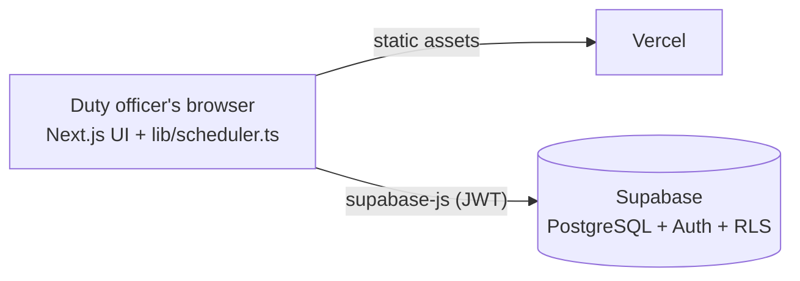

# ROCAF Roster — Guard Duty Scheduler

**English** | [繁體中文](README.zh-TW.md)

A web app that builds the daily guard-duty roster for a military base. It replaces a hand-made spreadsheet with a
constraint-satisfaction scheduler that never breaks the rest and fairness rules, then lets the duty officer
fine-tune the result before saving it.

**Live deployment:** [rocaf-roster.vercel.app](https://rocaf-roster.vercel.app) (login required)


---

## The problem

A guard post is staffed around the clock in **12 two-hour shifts**, each needing **one sergeant of the guard
(哨長) and one sentry (槍兵)**: 24 slots every day. Building that roster by hand is slow and error-prone,
because every assignment must respect several rules at once:

- Only qualified people can lead a shift.
- After a 2-hour shift, a person must rest **at least 6 hours**, including across midnight.
- The graveyard slots (00:00–06:00 and 12:00–14:00) must not land on the same person **three days in a row**.
- People work different numbers of days per month (leave, off-base duties), yet the load should feel equal.

A manual roster usually gets one of these wrong, and fairness is hard to judge by eye.

## Features

- **Personnel management:** add, edit, deactivate, or delete members, each tagged as *Sergeant* (can fill either
  role) or *Sentry only*. Each person's monthly working days, shifts stood, graveyard shifts, and fairness ratio are shown.
- **Daily scheduling wizard:**
  1. Tick who is available that day.
  2. Minimum-manpower check: blocks scheduling with a clear warning if fewer than 8 people, or fewer than
     4 sergeants, are available.
  3. Records attendance (the denominator of the fairness ratio).
  4. Generates the roster automatically.
  5. Hand-tuning: every cell is a dropdown with live rule checking. Edited cells auto-lock so re-generation keeps them.
- **Roster history:** one click to view any of the last 7 days (plus tomorrow), or look up any past date.
- **Idempotent bookkeeping:** monthly counts are derived from attendance and roster records, never stored
  as counters, so re-generating or re-saving a day can't double-count.
- **Secure by default:** Supabase Auth login plus PostgreSQL Row Level Security; anonymous visitors cannot read any data.

| Pick available personnel | Minimum-manpower guard |
| --- | --- |
|  |  |
| **Roster history** | **Personnel & fairness stats** |
|  |  |

## The scheduling algorithm

The core lives in [`lib/scheduler.ts`](lib/scheduler.ts): a pure, dependency-free TypeScript module that
runs both in the browser and in Node tests.

### Hard constraints

| Rule | How it is enforced |
| --- | --- |
| Qualification | Sergeant slots accept only sergeants; sentry slots accept anyone. |
| 6-hour rest, across days | Every shift is mapped to an **absolute slot index**: `dayOffset × 12 + shiftIndex`. Two shifts by the same person must be ≥ 4 slots apart (2 h on + 6 h rest = 8 h). Yesterday's shifts become negative indices, so yesterday's 22:00 shift (`-1`) automatically blocks 00:00–06:00 today, with no special-case code. |
| No graveyard shift 3 days in a row | Each person has a set of days on which they stood a graveyard shift. A graveyard slot today is rejected if any 3-day window containing today (D-2..D, D-1..D+1, D..D+2) would become all graveyard. Checking forward windows means re-planning a past day can't break a roster already saved for a later date. |

The rest rule also caps each person at 3 shifts per day (slots 0, 4, 8), which is where the
8-person minimum comes from.

### Search strategy

1. **Backtracking with MRV** (minimum remaining values): always fill the slot with the fewest eligible people
   first, and prune as soon as any slot has none. This either finds a complete roster or proves none exists
   within a node budget.
2. **Fairness-ordered candidates:** candidates are tried in order of their *projected* fairness ratio
   (`shifts this month / days worked`), with a small random jitter so equally ranked people are shuffled.
3. **Graveyard fairness:** for graveyard slots, candidates are also ranked by
   `graveyard shifts this month / days worked`, with penalties if they stood one yesterday or the day before.
   This prevents a fully compliant but unfair "on, on, off, on, on…" pattern.
4. **Graceful degradation:** if no complete roster exists, many randomized greedy passes keep the
   result with the fewest gaps. Each empty slot explains *why* it couldn't be filled (e.g. "3 people still resting").

### Validated by simulation

[`scripts/test-scheduler.ts`](scripts/test-scheduler.ts) schedules 30 consecutive days with random leave, then
re-checks every rule with an **independent**, hour-based checker:

| Scenario (30 days, 14 people, ~11 available per day) | Rule violations | Shifts / day worked | Graveyard / day worked |
| --- | --- | --- | --- |
| Random seed A | 0 | 2.08 – 2.28 | 0.60 – 0.79 |
| Random seed B | 0 | 2.00 – 2.14 | 0.64 – 0.75 |

With 50 people, adding graveyard fairness narrowed the spread from **0–8** to **3–6** graveyard shifts per person per month.

The simulation also showed that **8 people is necessary but not sufficient**. With exactly 8, everyone is locked
into a fixed 3-shift pattern every day, and three of the four possible patterns contain a graveyard slot, so the
3-day rule eventually forces gaps. The app reports these gaps instead of silently breaking a rule.

## Architecture



The scheduler runs entirely in the browser, so there is no server code to host or secure. All data access goes
through Supabase's REST API, guarded by Row Level Security policies that allow only authenticated users.

### Data model ([`supabase/schema.sql`](supabase/schema.sql))

| Table | Purpose |
| --- | --- |
| `members` | Name, qualification (`leader` / `guard`), active flag, note |
| `attendance` | One row per person per working day (primary key `member_id, work_date`) |
| `duty_assignments` | `duty_date, shift_index (0–11), role, member_id`; unique per slot, and one person can't hold both roles in a shift |

RPCs: `member_month_stats` (monthly counts), `set_attendance` (overwrite a day's attendance),
`save_duty_roster` (replace a day's roster atomically).

## Getting started

**Prerequisites:** Node.js 22+, a free [Supabase](https://supabase.com) project.

1. In the Supabase **SQL Editor**, run [`supabase/schema.sql`](supabase/schema.sql).
2. Under **Authentication → Users**, create a login. Disable public sign-ups under **Sign In / Providers**.
3. Configure and run locally:
   ```bash
   cp .env.local.example .env.local   # fill in Project URL and publishable (anon) key
   npm install
   npm run dev                         # http://localhost:3000
   ```
4. **Deploy:** import the repository in [Vercel](https://vercel.com) and set the same two environment variables.
   Every push to `main` redeploys automatically.

```bash
npm run test:scheduler   # 30-day simulation with independent constraint checks
npm run build            # production build
```

## Project structure

```
app/                     Next.js App Router pages (schedule, history, members)
components/
  ScheduleWizard.tsx     5-step wizard, manpower guard
  RosterEditor.tsx       hand-tuning grid, live validation, fairness panel
  RosterHistory.tsx      last-7-days viewer
  MemberManager.tsx      personnel CRUD and monthly stats
  AuthGate.tsx           Supabase Auth login gate
lib/
  scheduler.ts           CSP solver, validator, manpower check (pure TypeScript)
  db.ts                  Supabase data access
supabase/
  schema.sql             tables, RPCs, RLS policies
  migrations/            incremental changes
scripts/
  test-scheduler.ts      30-day simulation test
```

## Roadmap

- Scheduled database backups via GitHub Actions
- Printable / exportable daily roster
- Per-person duty calendar view
