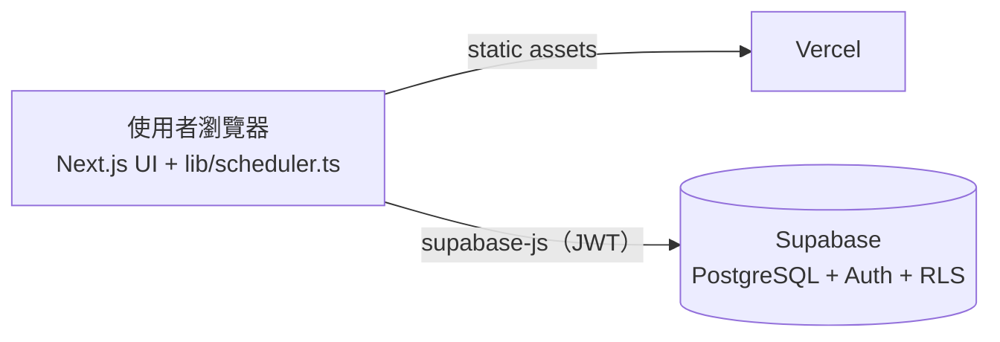

# ROCAF Roster — 營區站哨排班系統

自動產生營區每日站哨表的 Web App。以 constraint satisfaction（限制滿足）演算法取代人工排表：
保證不違反歇哨與灰色時段規定，並依公平值分配勤務；排完後可人工微調，再儲存到資料庫。

**線上版：** [rocaf-roster.vercel.app](https://rocaf-roster.vercel.app)（需登入）


---

## 要解決的問題

哨所 24 小時運作，一天 **12 班、每班 2 小時**，每班需要 **哨長 1 人＋槍兵 1 人**，每天共 24 個班次。
人工排表除了耗時，還要同時顧到以下規定，很容易出錯：

- 哨長位置只能由具哨長資格的人擔任。
- 站完 2 小時後必須**至少休息 6 小時**，而且要跨日計算。
- 灰色時段（00:00–06:00、12:00–14:00）**不可連續三天**排給同一人。
- 每個人當月上班天數不同（休假、公差），但勤務負擔要公平。

## 功能

- **人員名冊：** 新增、編輯、停用、刪除人員。資格分為「哨長」（哨長、槍兵都能站）與「僅槍兵」。
  每個人的當月上班天數、站哨節數、灰色節數與公平值都會即時統計。
- **每日排哨精靈（Wizard）：**
  1. 勾選當天可動用的人員；人力儀表會即時顯示是否達到最低門檻與建議人力。
  2. 最低人力檢核：少於 8 人或哨長少於 4 人時，跳出警告並停止排哨；
     低於建議人力（12 人／哨長 6 人）時只提醒，不阻擋。
  3. 登錄出勤，作為公平值的分母。
  4. 自動產生哨表。
  5. 人工微調：每一格都能修改，並即時檢查規定；改過的格子自動鎖定，重新排哨時不會被覆蓋。
- **哨表紀錄：** 一鍵查看最近 7 天（含明天）的哨表，也可以查詢任何日期。
- **統計具冪等性（idempotent）：** 上班天數與站哨節數由出勤與哨表紀錄即時算出，不是存成 +1 的計數器，
  重複產生或重新儲存都不會重複計算。
- **資料安全：** Supabase Auth 登入，搭配 PostgreSQL Row Level Security（RLS），未登入者無法讀取任何資料。

| 勾選可動用人員 | 最低人力防呆 |
| --- | --- |
|  |  |
| **哨表紀錄** | **人員名冊與公平值** |
|  |  |

## 排哨演算法

核心程式在 [`lib/scheduler.ts`](lib/scheduler.ts)，是沒有任何外部依賴的 pure function 模組，
網頁與測試程式共用同一份。

### Hard constraints（硬性規定）

| 規定 | 做法 |
| --- | --- |
| 資格吻合 | 哨長位只能排哨長；槍兵位兩種資格都可以。 |
| 歇哨 6 小時（跨日） | 每一班換算成 absolute slot index：`天數差 × 12 + 班次`。同一人任兩班的差距必須 ≥ 4（站 2 小時＋休 6 小時＝8 小時）。昨天的班次是負數，例如昨天 22:00 那班是 `-1`，會自動擋掉今天 00:00–06:00，不需要另寫跨日的特例。 |
| 不可連續三天灰色時段 | 記錄每個人站過灰色時段的日期。要排今天的灰色班時，檢查所有包含今天的三天 sliding window（前天～今天、昨天～明天、今天～後天），任一 window 會變成三天都灰色就禁止。往後的 window 是為了重排過去某天時，不會破壞之後已存好的哨表。 |

歇哨規定也代表每人每天最多 3 班（第 0、4、8 班），這就是「最低 8 人」的由來。

### Soft constraints（公平性）

- **公平值** = 當月站哨節數 ÷ 當月上班天數。候選人依「排入這班之後的公平值」由低到高嘗試。
- **Random jitter：** 加入以「節」為單位的隨機擾動（預設 0.5 節），讓累計節數差不到半節的人隨機輪替，
  避免每天都是同一批人排在前面。
- **灰色公平值** = 當月灰色節數 ÷ 上班天數。排灰色班時額外參考；昨天或前天站過灰色的人會被扣分，
  避免「灰、灰、休、灰、灰…」這種每天都合規、卻一直輪到同一人的模式。

### 搜尋策略

1. **Backtracking + MRV（Minimum Remaining Values）heuristic：** 每次先填「可排人選最少」的格子，
   一旦有格子沒人可排就立刻 prune，在 node budget 內找出完整哨表，或確認不可能排滿。
2. **Graceful degradation：** 排不滿時，改跑多輪 randomized greedy，保留空缺最少的結果，
   並標示每個空缺的原因（例如「3 人歇哨未滿 6 小時」），交由人工處理。

## 驗證與模擬

所有驗證、測試與模擬都記錄在 [`docs/experiments/`](docs/experiments/)，**不論結果好壞**，
包含被推翻的結論與已知限制。

### 情境模擬（Scenario-based simulation）

[`scripts/simulate.ts`](scripts/simulate.ts) 設計了 12 種情境：標準單位、小單位、大單位、極限 8 人、
哨長稀缺、週末大休、長假、中途報到／離營、出勤劇烈波動、固定輪休等。每個情境連續排 30 天，
以 **30 個 random seed** 重複執行，再做月結算。

- 所有規定都由另一套**獨立實作**、以小時計算的 checker 重新驗證，避免「演算法自己檢查自己」。
- 月結算偏差 = 每人「實際節數 − 應得節數」，應得 = 上班天數 × 全單位平均（節／上班天）。

### 以統計學支撐「公平」

為了回答「公平是演算法的功勞，還是規定本身就會造成的」，模擬加入了**對照組（control group）**：
只遵守硬性規定、完全隨機排人，並使用完全相同的出勤資料。

| 指標 | 現行版本 | 對照組（隨機） |
| --- | --- | --- |
| 月結算偏差 RMS（節） | 0.36～0.68 | 3.31～7.66 |
| Gini coefficient | 0.003～0.016 | 0.051～0.239 |
| Dispersion index（χ²／df，純抽籤 ≈ 1） | 0.00～0.02 | 0.33～2.58 |
| 灰色時段偏差 RMS（節） | 0.32～0.78 | 2.52～3.25 |

- **Mann-Whitney U test：** 9 個情境全部 p < 0.001，偏差約為對照組的 1/10 到 1/20。
- **Chi-square goodness-of-fit test：** 所有 run 都不拒絕「依上班天數比例分配」，沒有人被系統性多排或少排。
- **Subgroup analysis：** 哨長的負擔比僅槍兵略高，以 seed 為獨立單位檢定時 8 個情境中 5 個達統計顯著，但效果量 < 2%（每月約 0.6 節），
  記錄為待觀察（[EXP-004](docs/experiments/EXP-004-statistical-validation.md)）。

### 實驗紀錄摘要

| 實驗 | 發現 | 處理 |
| --- | --- | --- |
| [EXP-001](docs/experiments/EXP-001-gray-fairness.md) | 規定之內，灰色時段仍會集中在少數人 | 加入灰色公平值：灰色偏差降為 1/3～1/6；代價是總偏差略增 ≤ 0.09 節、小單位空缺 +1 格／月 |
| [EXP-002](docs/experiments/EXP-002-jitter-unit.md) | Jitter 以公平值為單位，月底被放大（上班 20 天時 0.3 = 6 節） | 改以「節」為單位：偏差 RMS 從約 0.85 降到約 0.45 節（p < 0.001） |
| [EXP-003](docs/experiments/EXP-003-manpower-thresholds.md) | 8 人只是必要門檻：9 人每月約 32 格空缺、12 人約 0.1 格；哨長 6 人以上才不缺 | 加入「建議 12 人／哨長 6 人」提醒（不阻擋） |
| [EXP-004](docs/experiments/EXP-004-statistical-validation.md) | 與對照組比較、統計檢定、消融實驗重新驗證 EXP-001／002；以 notebook 獨立重算 | 修正 EXP-001 一項過度樂觀的結論；發現並修正 `stats.ts` 的 tie 判斷 bug |

完整數據見 [`docs/simulation-report.md`](docs/simulation-report.md) 與
[`docs/experiments/results/ablation.md`](docs/experiments/results/ablation.md)。

### 可重現性（Reproducibility）

每份實驗報告都附有產生它的程式碼，任何人都能重跑並得到相同的數字：

| 實驗 | Notebook（分析與圖表） | 原始數據 | 程式碼 |
| --- | --- | --- | --- |
| EXP-001 灰色時段公平值 | [EXP-001-gray-fairness.ipynb](docs/experiments/EXP-001-gray-fairness.ipynb) | [data/exp-001](docs/experiments/data/exp-001/) | [exp-001-gray-fairness.ts](scripts/experiments/exp-001-gray-fairness.ts) |
| EXP-002 Jitter 單位 | [EXP-002-jitter-unit.ipynb](docs/experiments/EXP-002-jitter-unit.ipynb) | [data/exp-002](docs/experiments/data/exp-002/) | [exp-002-jitter-unit.ts](scripts/experiments/exp-002-jitter-unit.ts) |
| EXP-003 建議人力門檻 | [EXP-003-manpower-thresholds.ipynb](docs/experiments/EXP-003-manpower-thresholds.ipynb) | [data/exp-003](docs/experiments/data/exp-003/) | [exp-003-manpower-thresholds.ts](scripts/experiments/exp-003-manpower-thresholds.ts) |
| EXP-004 統計驗證 | [EXP-004-statistical-validation.ipynb](docs/experiments/EXP-004-statistical-validation.ipynb) | [data/exp-004](docs/experiments/data/exp-004/) | [exp-004-statistical-validation.ts](scripts/experiments/exp-004-statistical-validation.ts) |

- **模擬用 TypeScript：** 直接使用網站上的排哨演算法，測的是真正上線的程式碼。
- **分析用 Python notebook：** 以 `numpy`、`scipy` 從原始數據重算所有統計量並繪圖，與 TypeScript 的結果逐一比對。
  這個比對**抓到了 `stats.ts` 的一個 bug**（浮點誤差使 Mann-Whitney U test 的 tie 判斷錯誤），已修正並記錄。
- **CI 驗證：** 演算法或實驗相關檔案變動時，重新產生四個實驗的原始數據，必須與 repo 中的檔案完全相同，再執行 notebook。

### 持續驗證（CI）

每次 push 到 GitHub，[GitHub Actions](.github/workflows/verify.yml) 都會自動執行
type check、regression test、情境模擬門檻檢查（違規必須為 0、公平性指標不得超過門檻）與 production build；
演算法或實驗相關檔案變動時，另一個 [workflow](.github/workflows/reproduce.yml) 會重現所有實驗。
任一項未通過即標示失敗，避免公平性在修改程式時不知不覺變差。

```bash
npm run simulate                # 完整報告（30 seeds），更新 docs/simulation-report.md
npm run simulate -- --ablation  # 消融實驗，更新 docs/experiments/results/ablation.md
npm run simulate -- --check     # CI 門檻檢查（10 seeds）
npm run simulate -- S4 S6       # 只跑指定情境
npm run test:scheduler          # regression test
npm run experiment -- scripts/experiments/exp-001-gray-fairness.ts   # 重現單一實驗（原始數據 → docs/experiments/data/）
```

執行 notebook 需要 Python 3.12：

```bash
pip install -r docs/experiments/requirements.txt
jupyter nbconvert --to notebook --execute docs/experiments/EXP-001-gray-fairness.ipynb --output-dir /tmp
```

## 系統架構



排哨演算法完全在瀏覽器執行，沒有需要維護的 server-side 程式。所有資料都透過 Supabase 的 REST API 存取，
並由 RLS policy 限制只有登入的帳號可以讀寫。

### 資料表（[`supabase/schema.sql`](supabase/schema.sql)）

| 資料表 | 內容 |
| --- | --- |
| `members` | 姓名、資格（`leader` 哨長／`guard` 僅槍兵）、是否在籍、備註 |
| `attendance` | 每人每個上班日一筆（primary key 為 `member_id, work_date`） |
| `duty_assignments` | `duty_date, shift_index (0–11), role, member_id`；每格只能有一人，同一人同班不能兼兩個位置 |

資料庫函式（RPC）：`member_month_stats`（當月統計）、`set_attendance`（覆寫某天出勤）、
`save_duty_roster`（以單一 transaction 替換整天哨表）。

## 架設與開發

**需要：** Node.js 22.6 以上（模擬與測試腳本使用 `--experimental-strip-types` 直接執行 TypeScript）、一個免費的 [Supabase](https://supabase.com) 專案。

1. 到 Supabase 的 **SQL Editor** 執行 [`supabase/schema.sql`](supabase/schema.sql)。
2. 到 **Authentication → Users** 建立登入帳號，並在 **Sign In / Providers** 關閉公開註冊。
3. 在本機設定並啟動：
   ```bash
   cp .env.local.example .env.local   # 填入 Project URL 與 publishable（anon）key
   npm install
   npm run dev                         # http://localhost:3000
   ```
4. **部署：** 在 [Vercel](https://vercel.com) 匯入此 repo，設定同樣兩個環境變數。之後每次 push 到 `main` 都會自動部署。

## 專案結構

```
app/                     Next.js App Router 頁面（每日排哨、哨表紀錄、人員名冊）
components/
  ScheduleWizard.tsx     排哨精靈五步驟、人力檢核
  RosterEditor.tsx       哨表微調、即時規定檢查、公平性檢視
  RosterHistory.tsx      最近 7 天哨表紀錄
  MemberManager.tsx      人員名冊與當月統計
  AuthGate.tsx           登入畫面
  Nav.tsx / Modal.tsx    導覽列、共用對話框
lib/
  scheduler.ts           排哨演算法、驗證、人力檢核（pure TypeScript）
  db.ts                  Supabase 資料存取
  supabase.ts            Supabase client
  date.ts                本地時區日期工具
supabase/
  schema.sql             資料表、RPC、RLS policy
  migrations/            後續的資料庫變更
scripts/
  sim-core.ts            情境定義、單月模擬、獨立 checker、月結算
  simulate.ts            模擬報告、CI 門檻、消融實驗
  experiments/           各實驗產生原始數據的腳本
  stats.ts               統計函式（chi-square、Gini、Mann-Whitney U、CI）
  test-scheduler.ts      regression test
docs/
  experiments/           實驗紀錄（.md）、分析 notebook（.ipynb）、原始數據（data/）、notebook 共用函式（nbutils.py）
  simulation-report.md   模擬報告（自動產生）
  screenshots/           介面截圖
.github/workflows/       GitHub Actions（CI）
```

## 未來規劃

- 透過 GitHub Actions 每日自動備份資料庫
- 哨表列印／匯出
- 個人勤務月曆檢視
- 跨月公平性：目前每月重新計算，月初的前幾天公平值較不穩定
