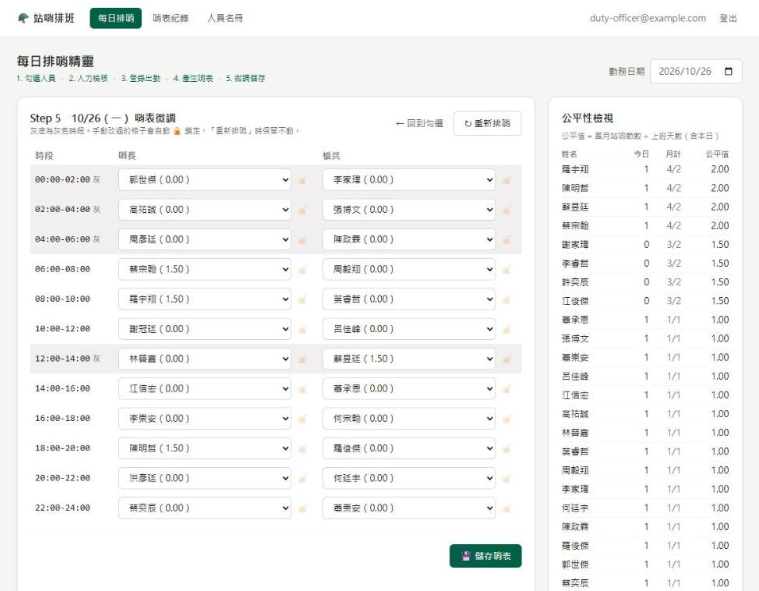
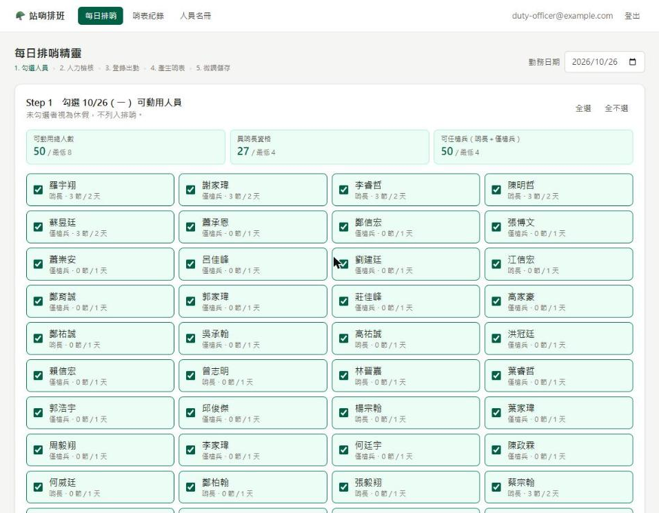
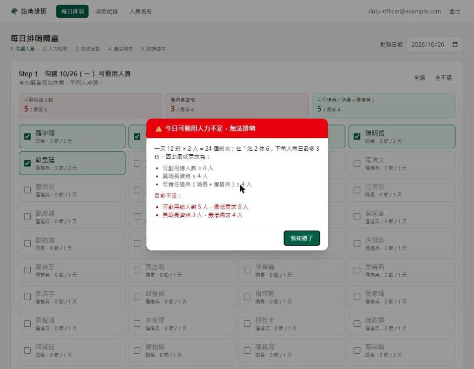
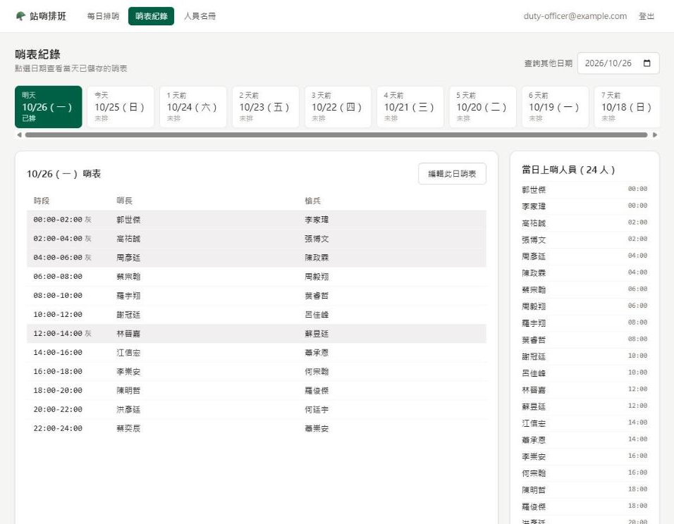
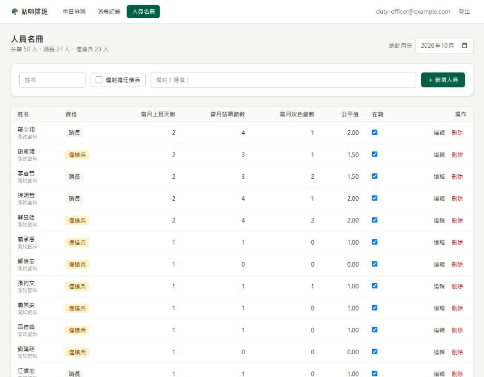
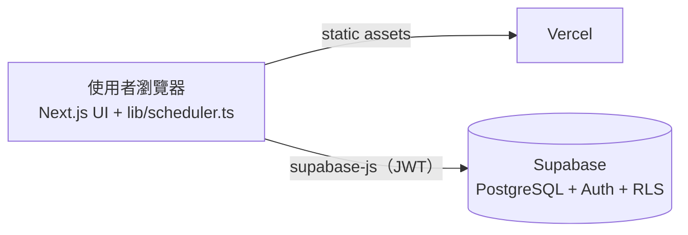

# ROCAF Roster — 營區站哨排班系統

自動產生營區每日站哨表的 Web App。以 constraint satisfaction（限制滿足）演算法取代人工排表：
保證不違反歇哨與灰色時段規定，並依公平值分配勤務；排完後可人工微調，再儲存到資料庫。

**線上版：** [rocaf-roster.vercel.app](https://rocaf-roster.vercel.app)（需登入）




---

## 要解決的問題

哨所 24 小時運作，一天 **12 班、每班 2 小時**，每班需要 **哨長 1 人＋槍兵 1 人**，每天共 24 個班次。
人工排表除了耗時，還要同時顧到以下規定，很容易出錯：

- 哨長位置只能由具哨長資格的人擔任。
- 站完 2 小時後必須**至少休息 6 小時**，而且要跨日計算。
- 灰色時段（00:00–06:00、12:00–14:00）**不可連續三天**排給同一人。
- 每個人當月上班天數不同（休假、公差），但勤務負擔要公平。

## 功能

- **人員名冊：** 新增、編輯、停用、刪除人員。資格分為「哨長」（哨長、槍兵都能站）與「僅槍兵」。
  每個人的當月上班天數、站哨節數、灰色節數與公平值都會即時統計。
- **每日排哨精靈（Wizard）：**
  1. 勾選當天可動用的人員；人力儀表會即時顯示是否達到最低門檻與建議人力。
  2. 最低人力檢核：少於 8 人或哨長少於 4 人時，跳出警告並停止排哨；
     低於建議人力（12 人／哨長 6 人）時只提醒，不阻擋。
  3. 登錄出勤，作為公平值的分母。
  4. 自動產生哨表。
  5. 人工微調：每一格都能修改，並即時檢查規定；改過的格子自動鎖定，重新排哨時不會被覆蓋。
- **哨表紀錄：** 一鍵查看最近 7 天（含明天）的哨表，也可以查詢任何日期。
- **統計具冪等性（idempotent）：** 上班天數與站哨節數由出勤與哨表紀錄即時算出，不是存成 +1 的計數器，
  重複產生或重新儲存都不會重複計算。
- **資料安全：** Supabase Auth 登入，搭配 PostgreSQL Row Level Security（RLS），未登入者無法讀取任何資料。

| 勾選可動用人員 | 最低人力防呆 |
| --- | --- |
|  |  |
| **哨表紀錄** | **人員名冊與公平值** |
|  |  |

## 排哨演算法

核心程式在 [`lib/scheduler.ts`](lib/scheduler.ts)，是沒有任何外部依賴的 pure function 模組，
網頁與測試程式共用同一份。

### Hard constraints（硬性規定）

| 規定 | 做法 |
| --- | --- |
| 資格吻合 | 哨長位只能排哨長；槍兵位兩種資格都可以。 |
| 歇哨 6 小時（跨日） | 每一班換算成 absolute slot index：`天數差 × 12 + 班次`。同一人任兩班的差距必須 ≥ 4（站 2 小時＋休 6 小時＝8 小時）。昨天的班次是負數，例如昨天 22:00 那班是 `-1`，會自動擋掉今天 00:00–06:00，不需要另寫跨日的特例。 |
| 不可連續三天灰色時段 | 記錄每個人站過灰色時段的日期。要排今天的灰色班時，檢查所有包含今天的三天 sliding window（前天～今天、昨天～明天、今天～後天），任一 window 會變成三天都灰色就禁止。往後的 window 是為了重排過去某天時，不會破壞之後已存好的哨表。 |

歇哨規定也代表每人每天最多 3 班（第 0、4、8 班），這就是「最低 8 人」的由來。

### Soft constraints（公平性）

- **公平值** = 當月站哨節數 ÷ 當月上班天數。候選人依「排入這班之後的公平值」由低到高嘗試。
- **Random jitter：** 加入以「節」為單位的隨機擾動（預設 0.5 節），讓累計節數差不到半節的人隨機輪替，
  避免每天都是同一批人排在前面。
- **灰色公平值** = 當月灰色節數 ÷ 上班天數。排灰色班時額外參考；昨天或前天站過灰色的人會被扣分，
  避免「灰、灰、休、灰、灰…」這種每天都合規、卻一直輪到同一人的模式。

### 搜尋策略

1. **Backtracking + MRV（Minimum Remaining Values）heuristic：** 每次先填「可排人選最少」的格子，
   一旦有格子沒人可排就立刻 prune，在 node budget 內找出完整哨表，或確認不可能排滿。
2. **Graceful degradation：** 排不滿時，改跑多輪 randomized greedy，保留空缺最少的結果，
   並標示每個空缺的原因（例如「3 人歇哨未滿 6 小時」），交由人工處理。

## 驗證與模擬

### 情境模擬（Scenario-based simulation）

[`scripts/simulate.ts`](scripts/simulate.ts) 設計了 12 種情境：標準單位、小單位、大單位、極限 8 人、
哨長稀缺、週末大休、長假、中途報到／離營、出勤劇烈波動、固定輪休等。每個情境連續排 30 天，
以 5 個 random seed 重複執行，再做月結算。

- 所有規定都由另一套**獨立實作**、以小時計算的 checker 重新驗證，避免「演算法自己檢查自己」。
- 月結算偏差 = 每人「實際節數 − 應得節數」，應得 = 上班天數 × 全單位平均（節／上班天）。

完整結果見 [`docs/simulation-report.md`](docs/simulation-report.md)，重點如下：

| 發現 | 數據 | 處理 |
| --- | --- | --- |
| 所有情境都沒有違規 | 12 情境 × 5 seeds，違規 0 | — |
| Jitter 以公平值為單位時，月底會被放大 | 上班 20 天時，0.3 的擾動等於 6 節；偏差 SD 約 0.8 節、最大 2～3 節 | 改以「節」為單位，SD 降到約 0.4 節、最大約 1 節 |
| 8 人只是必要門檻，不是充分條件 | 全勤每月空缺：9 人 ≈ 37 格、10 人 ≈ 13 格、11 人 ≈ 0.3 格、12 人 = 0 | 加入「建議人力 12 人」提醒 |
| 哨長稀缺時，空缺必然落在哨長位 | 哨長 4 人 ≈ 31 格、5 人 ≈ 7 格、6 人 = 0；演算法從未把哨長浪費在槍兵位 | 加入「建議哨長 6 人」提醒 |
| 灰色時段過度集中在少數人 | 50 人單位中每人每月灰色節數 0～8 節 | 加入灰色公平值後縮小為 3～6 節 |
| 出勤人數每天差異很大時，偏差較大 | 偏差 SD 約 0.7 節、最大約 2.4 節 | 結構性限制：人少的日子每人都得多站 |

最慢的情境產生一天哨表約 0.16 秒，使用者幾乎感覺不到等待。

```bash
npm run simulate           # 全部情境，並更新 docs/simulation-report.md
npm run simulate -- S4 S6  # 只跑指定情境
npm run test:scheduler     # regression test
```

## 系統架構



排哨演算法完全在瀏覽器執行，沒有需要維護的 server-side 程式。所有資料都透過 Supabase 的 REST API 存取，
並由 RLS policy 限制只有登入的帳號可以讀寫。

### 資料表（[`supabase/schema.sql`](supabase/schema.sql)）

| 資料表 | 內容 |
| --- | --- |
| `members` | 姓名、資格（`leader` 哨長／`guard` 僅槍兵）、是否在籍、備註 |
| `attendance` | 每人每個上班日一筆（primary key 為 `member_id, work_date`） |
| `duty_assignments` | `duty_date, shift_index (0–11), role, member_id`；每格只能有一人，同一人同班不能兼兩個位置 |

資料庫函式（RPC）：`member_month_stats`（當月統計）、`set_attendance`（覆寫某天出勤）、
`save_duty_roster`（以單一 transaction 替換整天哨表）。

## 架設與開發

**需要：** Node.js 22 以上、一個免費的 [Supabase](https://supabase.com) 專案。

1. 到 Supabase 的 **SQL Editor** 執行 [`supabase/schema.sql`](supabase/schema.sql)。
2. 到 **Authentication → Users** 建立登入帳號，並在 **Sign In / Providers** 關閉公開註冊。
3. 在本機設定並啟動：
   ```bash
   cp .env.local.example .env.local   # 填入 Project URL 與 publishable（anon）key
   npm install
   npm run dev                         # http://localhost:3000
   ```
4. **部署：** 在 [Vercel](https://vercel.com) 匯入此 repo，設定同樣兩個環境變數。之後每次 push 到 `main` 都會自動部署。

## 專案結構

```
app/                     Next.js App Router 頁面（每日排哨、哨表紀錄、人員名冊）
components/
  ScheduleWizard.tsx     排哨精靈五步驟、人力檢核
  RosterEditor.tsx       哨表微調、即時規定檢查、公平性檢視
  RosterHistory.tsx      最近 7 天哨表紀錄
  MemberManager.tsx      人員名冊與當月統計
  AuthGate.tsx           登入畫面
lib/
  scheduler.ts           排哨演算法、驗證、人力檢核（pure TypeScript）
  db.ts                  Supabase 資料存取
supabase/
  schema.sql             資料表、RPC、RLS policy
  migrations/            後續的資料庫變更
scripts/
  simulate.ts            情境模擬與月結算
  test-scheduler.ts      regression test
docs/
  simulation-report.md   模擬報告（自動產生）
  screenshots/           介面截圖
```

## 未來規劃

- 透過 GitHub Actions 每日自動備份資料庫
- 哨表列印／匯出
- 個人勤務月曆檢視
- 跨月公平性：目前每月重新計算，月初的前幾天公平值較不穩定
