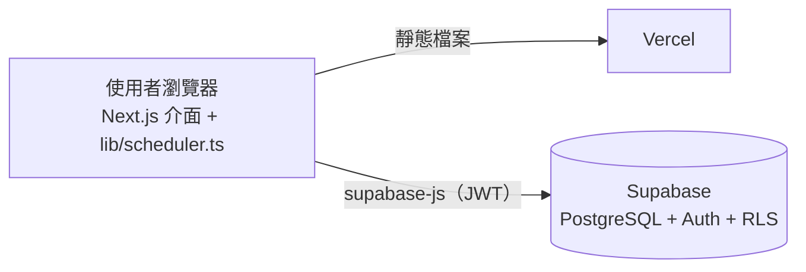

# ROCAF Roster — 營區站哨排班系統

[English](README.md) | **繁體中文**

自動產生營區每日站哨表的網頁系統。以限制滿足（CSP）演算法取代人工排表：保證不違反歇哨與灰色時段規定，
並依公平值分配勤務，排完後還可以人工微調再儲存。

**線上版：** [rocaf-roster.vercel.app](https://rocaf-roster.vercel.app)（需登入）


---

## 解決的問題

哨所 24 小時運作，一天 **12 班、每班 2 小時**，每班需要 **哨長 1 人＋槍兵 1 人**，每天共 24 個班次。
人工排表除了耗時，還要同時顧到以下規定，很容易出錯：

- 哨長位置只能由具哨長資格的人擔任。
- 站完 2 小時後必須**至少休息 6 小時**，而且要跨日計算。
- 灰色時段（00:00–06:00、12:00–14:00）**不可連續三天**排給同一人。
- 每個人當月上班天數不同（休假、公差），但勤務負擔要公平。

## 功能

- **人員名冊：** 新增、編輯、停用、刪除人員。資格分為「哨長」（哨長、槍兵都能站）與「僅槍兵」。
  每個人的當月上班天數、站哨節數、灰色節數與公平值都會即時統計。
- **每日排哨精靈：**
  1. 勾選當天可動用的人員。
  2. 最低人力檢核：可動用人數少於 8 人，或哨長少於 4 人時，跳出警告並停止排哨。
  3. 登錄出勤，作為公平值的分母。
  4. 自動產生哨表。
  5. 人工微調：每一格都能改，改的同時即時檢查規定；改過的格子自動鎖定，重新排哨時不會被覆蓋。
- **哨表紀錄：** 一鍵查看最近 7 天（含明天）的哨表，也可以查詢任何日期。
- **統計不會重複計算：** 上班天數與站哨節數是由出勤與哨表紀錄即時算出，不是存成 +1 的數字，
  重複產生或重新儲存都不會灌水。
- **資料安全：** 使用 Supabase 帳號登入，搭配 PostgreSQL Row Level Security，未登入者無法讀取任何資料。

| 勾選可動用人員 | 最低人力防呆 |
| --- | --- |
|  |  |
| **哨表紀錄** | **人員名冊與公平值** |
|  |  |

## 排哨演算法

核心程式在 [`lib/scheduler.ts`](lib/scheduler.ts)，是不依賴任何套件的純 TypeScript 模組，
網頁和測試程式都直接使用同一份。

### 硬性規定

| 規定 | 做法 |
| --- | --- |
| 資格吻合 | 哨長位只能排哨長；槍兵位兩種資格都可以。 |
| 歇哨 6 小時（跨日） | 每一班換算成「絕對班次索引」：`天數差 × 12 + 班次`。同一人任兩班的差距必須 ≥ 4（站 2 小時＋休 6 小時＝8 小時）。昨天的班次是負數，例如昨天 22:00 那班是 `-1`，會自動擋掉今天 00:00–06:00，不需要另寫跨日的特例。 |
| 不可連續三天灰色時段 | 記錄每個人站過灰色時段的日期。要排今天的灰色班時，檢查所有包含今天的三天區間（前天～今天、昨天～明天、今天～後天），任一區間會變成三天都灰色就禁止。往後的區間是為了重排過去某天時，不會破壞之後已存好的哨表。 |

歇哨規定也代表每人每天最多 3 班（第 0、4、8 班），這就是「最低 8 人」的由來。

### 搜尋策略

1. **回溯搜尋 + MRV：** 每次先填「可排人選最少」的格子，一旦有格子沒人可排就立刻回頭，
   在節點上限內找出完整哨表，或確認不可能排滿。
2. **公平值排序：** 候選人依「排入這班之後的公平值」（當月站哨節數 ÷ 上班天數）由低到高嘗試，
   加上少量隨機，讓條件相近的人隨機輪替。
3. **灰色公平值：** 排灰色班時，再依「當月灰色節數 ÷ 上班天數」排序；昨天或前天站過灰色的人會被扣分，
   避免出現「灰、灰、休、灰、灰…」這種每天都合規、卻一直輪到同一人的情況。
4. **排不滿時：** 改跑多輪隨機排法，保留空缺最少的結果，並標示每個空缺的原因
   （例如「3 人歇哨未滿 6 小時」），交由人工處理。

### 模擬測試結果

[`scripts/test-scheduler.ts`](scripts/test-scheduler.ts) 連續排 30 天、每天隨機有人休假，
再用另一套**獨立實作**、以小時計算的檢查程式重新驗證所有規定：

| 情境（30 天、14 人、每天約 11 人可動用） | 違規 | 站哨節數 ÷ 上班天數 | 灰色節數 ÷ 上班天數 |
| --- | --- | --- | --- |
| 亂數組 A | 0 | 2.08 – 2.28 | 0.60 – 0.79 |
| 亂數組 B | 0 | 2.00 – 2.14 | 0.64 – 0.75 |

50 人的情境下，加入灰色公平值後，每人每月灰色節數的差距從 **0–8 節**縮小到 **3–6 節**。

模擬也證實 **8 人只是必要門檻，不保證排得滿**：剛好 8 人時，每個人每天都被鎖在固定的 3 班組合，
而四種組合中有三種包含灰色時段，連續幾天後一定會違反三天規定。系統會把這種情況標示為空缺，
而不是偷偷違反規定。

## 系統架構



排哨演算法完全在瀏覽器執行，沒有需要額外維護的伺服器程式。所有資料都透過 Supabase 的 REST API 存取，
並由 Row Level Security 限制只有登入的帳號可以讀寫。

### 資料表（[`supabase/schema.sql`](supabase/schema.sql)）

| 資料表 | 內容 |
| --- | --- |
| `members` | 姓名、資格（`leader` 哨長／`guard` 僅槍兵）、是否在籍、備註 |
| `attendance` | 每人每個上班日一筆（主鍵 `member_id, work_date`） |
| `duty_assignments` | `duty_date, shift_index (0–11), role, member_id`；每格只能有一人，同一人同班不能兼兩個位置 |

資料庫函式：`member_month_stats`（當月統計）、`set_attendance`（覆寫某天出勤）、
`save_duty_roster`（一次替換整天哨表）。

## 架設與開發

**需要：** Node.js 22 以上、一個免費的 [Supabase](https://supabase.com) 專案。

1. 到 Supabase 的 **SQL Editor** 執行 [`supabase/schema.sql`](supabase/schema.sql)。
2. 到 **Authentication → Users** 建立登入帳號，並在 **Sign In / Providers** 關閉公開註冊。
3. 在本機設定並啟動：
   ```bash
   cp .env.local.example .env.local   # 填入 Project URL 與 publishable（anon）key
   npm install
   npm run dev                         # http://localhost:3000
   ```
4. **部署：** 在 [Vercel](https://vercel.com) 匯入此 repo，設定同樣兩個環境變數。之後每次推送到 `main` 都會自動部署。

```bash
npm run test:scheduler   # 30 天模擬測試（獨立驗證所有規定）
npm run build            # 正式版建置
```

## 專案結構

```
app/                     Next.js 頁面（每日排哨、哨表紀錄、人員名冊）
components/
  ScheduleWizard.tsx     排哨精靈五步驟、最低人力防呆
  RosterEditor.tsx       哨表微調、即時規定檢查、公平性檢視
  RosterHistory.tsx      最近 7 天哨表紀錄
  MemberManager.tsx      人員名冊與當月統計
  AuthGate.tsx           登入畫面
lib/
  scheduler.ts           排哨演算法、驗證、最低人力檢核（純 TypeScript）
  db.ts                  Supabase 資料存取
supabase/
  schema.sql             資料表、資料庫函式、RLS 權限
  migrations/            後續的資料庫變更
scripts/
  test-scheduler.ts      30 天模擬測試
```

## 未來規劃

- 透過 GitHub Actions 每日自動備份資料庫
- 哨表列印／匯出
- 個人勤務月曆檢視
